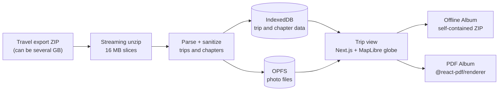

# Journey Vault

**Turn your Polarsteps travel export into a private, interactive archive, then take it with you as an offline website or a printable PDF photo book.**

**Live:** https://journeyvault.vercel.app

Travel apps hold years of photos and stories, and if the app shuts down or changes, those memories go with it. Journey Vault imports the data export the app already gives you and turns it into a trip you can browse. You can then export it as files that need no app, account or server to open.

## Highlights

- **No backend.** Imported trips and photos are processed and stored in your browser, not on a server.
- **Interactive trip view** with a 3D globe that flies to each stop as you scroll, chapter navigation, trip stats and a photo lightbox.
- **Offline Album export:** a single ZIP. Unzip it, double-click `index.html`, and the full interactive trip opens straight from disk, globe included, with no internet connection.
- **PDF Album export:** a printable A4 photo book with justified photo spreads. It handles Hebrew and Arabic (right-to-left), CJK, Thai and Devanagari text, plus emoji.
- **Well tested:** about 470 unit and integration tests (Vitest + React Testing Library) and Playwright end-to-end tests for the import flows.
- **Spec-driven AI development:** built with a custom multi-agent workflow with human approval gates (see [How it was built](#how-it-was-built)).

## Architecture



## Engineering notes

### An offline export that works from `file://`

A page opened straight from disk can't use `fetch()`, ES modules or file-based Web Workers. That's a problem for an interactive map, which loads tiles, fonts and a worker at runtime. The Offline Album works around each restriction:

- **Map assets as scripts.** Map tiles (PMTiles), glyph fonts and sprites are base64-encoded into plain `<script>` files, which do load from `file://`, and registered in an in-memory asset registry.
- **Custom map protocols.** MapLibre protocol handlers (`vault-fonts://`, `vault-sprites://`, and PMTiles from a blob URL) serve those assets from memory.
- **Blob-URL worker.** The MapLibre web worker is inlined and started from a blob URL, which browsers allow.
- **Embedded trip data.** Trip data is embedded directly in `index.html`, with `<` escaped so user text can't close the script tag. Photos are ordinary relative image files.
- **Same components as the app.** The viewer is a separate Vite bundle that reuses the app's own trip components with a different data layer, so the export looks exactly like the app. A build-time guard fails the bundle if any Next.js import leaks into it.
- **Streamed ZIP.** The archive is assembled with streaming compression (fflate), with live progress and cancel support.

### Storage that scales to real exports

- **Split storage.** Trip and chapter data lives in IndexedDB. Photos live as files in the Origin Private File System (OPFS) under `photos/<trip>/<chapter>/`, so deleting a trip means deleting a folder. Photos moved there from IndexedDB blobs because hundreds of multi-MB images bloated the database and slowed imports.
- **Large ZIPs.** The export ZIP is read in 16 MB slices, so multi-gigabyte exports import fine. This also sidesteps a ZIP64 offset bug in fflate's synchronous API on files over 4 GB.
- **Safe re-imports.** Multi-trip exports let you choose which trips to import. Re-importing a trip replaces it cleanly and removes orphaned photo files. Running out of browser storage shows a clear "not enough storage space" error.
- **Sanitized input.** HTML is stripped from imported text.

### A PDF that looks like a real photo book

- **Real PDF text.** The PDF is generated in the browser with `@react-pdf/renderer`, so text is real, selectable PDF text, not a screenshot.
- **Balanced photo pages.** Photos are sorted by aspect ratio and laid out as one justified strip per chapter. The rows are then spread evenly across pages. Each page picks the row grouping that fills the most space without cropping a single photo. This avoids both the half-empty last page that greedy packing produces and portraits with their edges cut off.
- **Any script.** Fonts are chosen per line by detecting the script (Noto Sans Hebrew, Arabic, Thai, Devanagari, Japanese, Korean). Right-to-left lines get right-to-left layout, with workarounds for bidi bugs in the PDF library's text engine, including a small patch to `@react-pdf/textkit`.

### Maps without a map provider

The globe runs on a self-hosted Protomaps basemap (a single PMTiles file read with HTTP range requests), plus self-hosted glyphs and sprites. There are no API keys and no tile server.

## Tech stack

Next.js 16 (App Router) · React 19 · TypeScript (strict) · Tailwind CSS v4 · shadcn/ui · Framer Motion · MapLibre GL + PMTiles · fflate · IndexedDB (idb) + OPFS · @react-pdf/renderer · Vite · Vitest + React Testing Library · Playwright · pnpm

## How it was built

Built between March and June 2026 with Claude Code, using a multi-agent pipeline defined in [`.claude/commands/`](.claude/commands/):

- **One command, idea to tested code.** `/orchestrate` runs a feature through product spec → UX design → implementation plan → code → code review → QA tests. Each step runs in a fresh subagent with its own role instructions.
- **Independent review passes.** The spec, design and plan each get a review pass that flags only medium- and high-severity issues, then a pass that fixes the real ones and explains why the rest are fine. Code goes through review, fixes and a second, lighter review.
- **Human approval gates.** Each phase needs human approval before the next one starts.
- **Shared rules.** A project constitution ([`.specify/memory/constitution.md`](.specify/memory/constitution.md)) sets the rules every agent follows: strict TypeScript, no feature without tests, defined empty/loading/error/success states, and changes small enough to review in one sitting.

The specs, design docs, plans, review notes and QA reports are all in [`.specify/specs/`](.specify/specs/). [`08-trip-export/design.md`](.specify/specs/08-trip-export/design.md) is a good example.

## Running locally

```bash
pnpm install
pnpm dev        # builds the export viewer and fonts, then starts Next.js on http://localhost:3000
pnpm test       # unit + integration tests
pnpm test:e2e   # Playwright (starts its own dev server on port 3099)
pnpm build      # production build
```

To try it with your own data, request a copy of your data from Polarsteps on polarsteps.com. They email you a download link, and you upload that ZIP on the Import page. Small synthetic exports for testing are in [`e2e/fixtures/`](e2e/fixtures/).

Analytics are off on localhost. Deployed builds read `NEXT_PUBLIC_POSTHOG_PROJECT_TOKEN` and `NEXT_PUBLIC_POSTHOG_HOST`.

---

Journey Vault is an independent project and is not affiliated with, endorsed by, or connected to Polarsteps. Map data © [OpenStreetMap](https://www.openstreetmap.org/copyright) contributors · Basemap by [Protomaps](https://protomaps.com).
